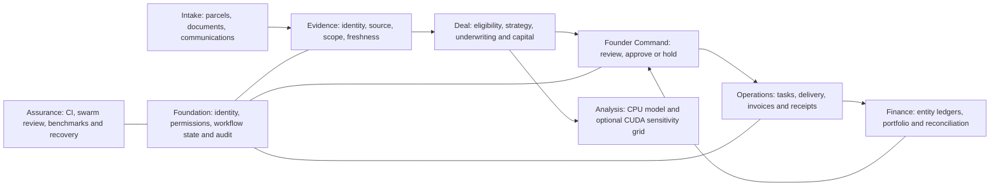
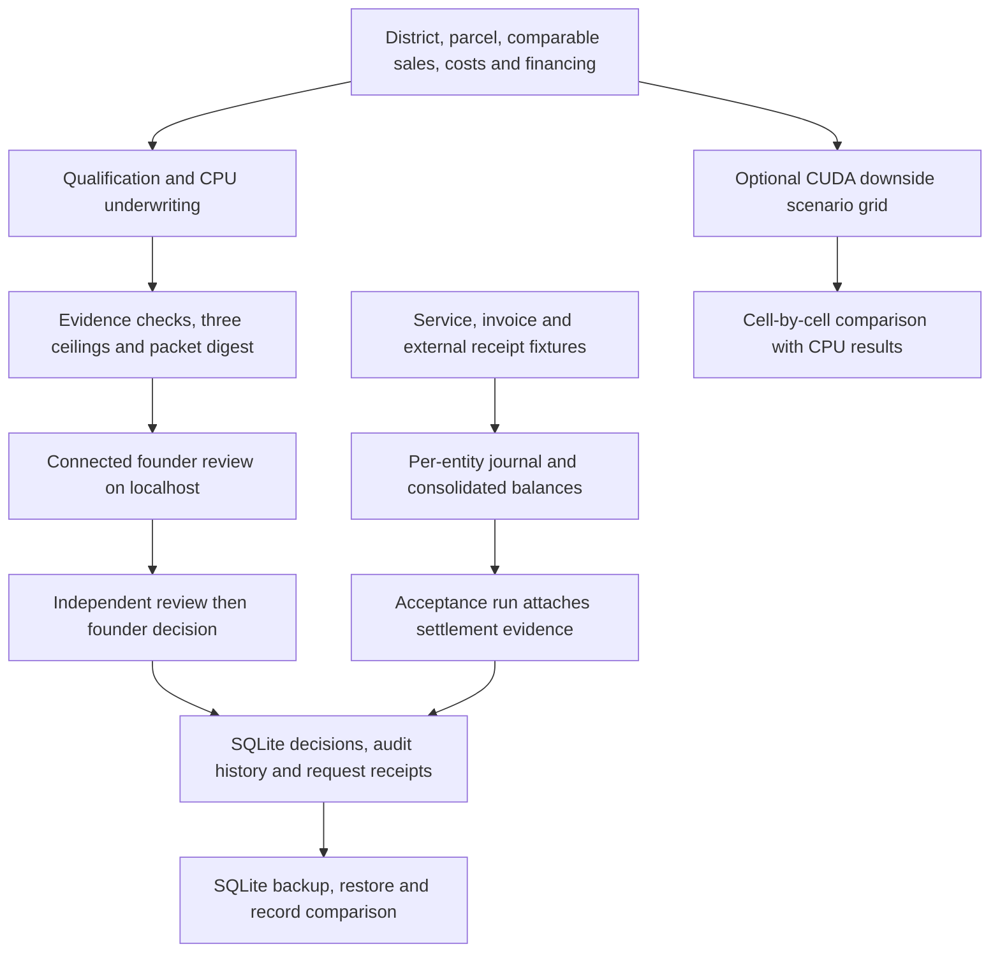

# Black River platform architecture

**The buyer’s question is “What can I pay for this property, and can someone else reconstruct that decision?”** Black River demonstrates that workflow on one synthetic acquisition. An analyst starts with a district thesis, three closed comparable sales and a funded purchase limit. A reviewer can follow the evidence to the ceiling, record a decision and recover the record after a restart. A second example shows what counts as collected cash across four entities.

The prospective buyer is an acquisition principal working with an analyst and a controller. The principal needs a ceiling and a rationale. The analyst needs to know which evidence is missing. The controller needs to distinguish an invoice from a receipt. A pilot evaluation can measure minutes to reconstruct a decision, cases held correctly for missing evidence and whether the team can reproduce the books after a restore.

## What the architecture terms mean

The [Machine of Machines reference](architecture/system-of-systems.md) pairs Black River terms with industry terminology and shows how to explain the architecture at four levels of detail.

| Term | Where it comes from | Black River example |
| --- | --- | --- |
| **System or platform** | Systems engineering and software product design. The whole set of parts that work together for a purpose. | Black River is a real estate acquisition and operations decision system. The executable pilot demonstrates one acquisition and its linked operating records. |
| **Business domain** | Business analysis and domain-driven design. The subject the software models. | Property acquisition, underwriting, construction, and portfolio operations. A parcel, offer, invoice, and receipt are business concepts. |
| **Layer** | Software architecture. A grouping by responsibility, such as presenting information, applying business rules, or storing records. | The browser presents the evidence and records user intent. The service enforces review and authorization. SQLite stores drafts and decisions. A layer here is a logical boundary. Several layers can run on the same machine. |
| **Engine** | Software design shorthand for a component that performs specialized calculations, applies rules, or processes data. | The underwriting engine computes the purchase ceilings. The CUDA engine processes a grid of downside assumptions. Search, GIS and optimization use the same word for different kinds of work. |
| **Module and service** | Software implementation and deployment. A module organizes code. A service provides an interface other parts can call. | `pilot/underwriting.py` is a module. The connected Founder review is a local HTTP service. A calculation engine may live inside a module and be called from a service. |
| **Workflow** | Operations and business process design. The ordered work that produces a result. | Intake → qualify → underwrite → review → approve or hold → record settlement. One workflow uses several engines and layers. |

In the Orchard example, underwriting belongs to the real estate finance domain. The underwriting engine applies the rules in the decision layer. The workflow sends the resulting packet to a reviewer, then stores the decision. Those terms describe three different aspects of the same event. [Underwriting guide](guides/underwriting.md)

## How the full system is mapped

The deal and its evidence are the thread through the system. Sources enter with a version and scope. A decision refers to that exact evidence. A task records what was done, and a receipt establishes what was settled. The screen presents the same chain to an operator. It sends decisions to the service for validation and recording.

| Platform area | Working path in this repository | Broader roadmap |
| --- | --- | --- |
| Intake and evidence | Synthetic parcel and evidence records, evidence expiry and an immutable underwriting packet. | Parcel and entity sources, corridor contacts, messaging and document intake, search and extraction. **E03, E08, E15, E17, E22** |
| Deal and capital | One synthetic acquisition from district thesis and comparables to eligibility, three price ceilings and approval. Optional CUDA downside grid. | Additional property and debt strategies, capital routing, entitlement, portfolio analytics and deal throughput. **E05, E06, E09–E13, E16, E19, E34** |
| Founder workspace | Responsive offline walkthrough plus a connected review screen on loopback. Two synthetic roles can review and approve a packet. An authorized actor can resume a versioned draft in another browser session. | Founder governance, connected map and evidence views, production identity and device acceptance. **E01, E25** |
| Operations and finance | Durable task claims, independent approval, separate invoice and receipt evidence, four-entity reconciliation and SQLite restore. | Revenue offers and delivery, field dispatch, operating pods, building and roof systems, tax and family office. **E04, E07, E14, E18, E21** |
| Foundation and assurance | Typed records, transactional SQLite, approval boundaries, version checks, replay tests, source guides and a GitHub workflow. | Production deployment, major integrations, reusable plugins, swarm governance, visibility, architecture modernization and benchmarks. **E02, E20, E23–E24, E26–E33** |

For schedules and acceptance criteria, the private engineering master holds the full E01–E34 roadmap. The public GitHub tracker links the implemented pilot and the open delivery work. [Delivery tracker](https://github.com/ajoiventures/BL_ACQ/issues/10)

The [intelligence engine map](architecture/intelligence-engines.md) traces the input, output, implementation evidence and roadmap ticket for each engine family.

The [architecture agent and swarm learning workflow](architecture/swarm-learning.md) connects the models to a reusable review skill, verified lessons and a local learning index.

## How the swarm makes a technical decision

| Batch | Engineering question | Evidence for the decision |
| --- | --- | --- |
| Foundation | Can a retry or another worker duplicate work? | Replay migrations, competing claims and lease expiry against a temporary database. |
| Domain | What qualifies the deal, binds its ceiling and counts as cash? | Compare integer-cent fixtures, test missing or stale sources, and reconcile source receipts against entity journals. |
| Experience | Can a reviewer resume the same authorized work and explain a decision? | Replay independent browser sessions, a stale update and a repeated approval. |
| Acceleration | Does GPU batching preserve the exact reference calculation? | Compare every cell, report the device and measure cold and warm runs. |

Record each decision in the relevant source guide, point to the regression test, and name what still requires independent acceptance. Start each review batch from the linked issue and revision in the [delivery tracker](https://github.com/ajoiventures/BL_ACQ/issues/10).

## Follow one decision

At the domain boundary, qualification checks the subject, source, observation date and expiry of evidence. Underwriting then takes the lowest of three purchase ceilings. In the Orchard fixture a $400,000 resale, 6% selling costs, $66,000 project costs and $75,000 required profit yield a **$235,000 base ceiling**. The downside ceiling is $242,400 and financing allows $254,000. At $235,001 the proposal exceeds the binding limit by one dollar. Missing financing, expired evidence and unresolved title also hold a bid. A digest binds the evidence, economics, proposed price, preparer and review date into one reviewable packet. [Underwriting walkthrough](guides/underwriting.md)

## Architecture decisions and trust boundaries

| Decision | What the pilot demonstrates | Engineering tradeoff |
| --- | --- | --- |
| Calculate money in integer cents on the CPU | The same evidence and inputs produce the same ceilings and audit packet. Whole basis points express percentage assumptions. | The rounding policy is explicit. A currency or product with different precision needs its own tested policy. |
| Keep browser rendering separate from decision authority | The connected page sends a proposed action to a loopback service. Scope, role, evidence version and expected revision are checked server-side. A request receipt supports idempotent retries. | The service uses local demo accounts with per-run access keys. Production identity, network deployment and physical-device acceptance require additional work. |
| Use SQLite transactions and task leases | A task claim, retry or completion has an audit trail. Competing browser edits can surface a revision conflict. One file can be backed up and restored for the pilot. | SQLite serializes writes. A multi-host rollout needs measured contention, a database migration and a shared identity service. |
| Separate accounting evidence by entity | An independently reviewed invoice debits receivables. An evidenced full receipt debits cash and clears receivables. A repeated receipt posts once. | The fixture covers external-customer service invoices. Partial receipts, intercompany eliminations and bank integration need additional contracts and fixtures. |
| Give CUDA the scenario grid | An optional NVIDIA runtime computes many downside ceilings in parallel and compares each result with the CPU implementation. | Device setup and transfer time are real costs. Use the measured elapsed time and equality check when deciding whether acceleration helps a particular workload. [CUDA guide](guides/cuda_screen.md) |

The connectors module defines where an external operation would be authorized. It checks the credential, workspace, allowed operation, resource and evidence version, then asks an approval journal to consume a matching approval once. The tests supply a memory-backed journal. A live adapter needs persistent approval consumption, vendor-specific delivery receipts and reconciliation for uncertain delivery. The founder review and accounting examples use synthetic identities, evidence and money. [Connector contract](guides/pilot_connectors.md)

## Teach the pilot in ten minutes

On Windows, run `code-map.cmd learn` to open the architecture, `code-map.cmd teach` for the recovery demo, and `code-map.cmd sell` to rehearse the buyer pitch. Run the commands below from the repository root with the learning workspace open. The [code map](code-map.md) pairs every maintained source with a reading guide.

| Time | Demonstrate | Explain |
| --- | --- | --- |
| 0–2 min | Run `uv run --no-project python -B -m pilot.scenario`. Find the three limits in `underwriting.limits`. | Ask the audience to identify the binding limit. Trace one comparable from its observation date to the qualification check. |
| 2–5 min | Run `uv run --no-project python -B -m pilot.founder_service --port 8766`. Open the local connected page printed by the service. Sign in as the reviewer, inspect evidence, enter a rationale and record the review. Sign out and repeat as founder to record the simulated approval. | The decision history shows two actors and their rationales. The service persists the checkpoint. Use a fresh demo database path with `--database` for a new presentation. Keep the terminal access keys off the projection. |
| 5–7 min | Return to the scenario report. Inspect an open invoice and a settled invoice. Compare the four entity balances to the consolidated totals. | The fixture contains $2,850 revenue, $800 receivables and $2,050 cash. Trace the two settled invoices to their separate receipt references. |
| 7–9 min | Run `uv run --no-project python -B -m pilot.acceptance`. | The acceptance run uses a disposable database, posts two review events, attaches reconciled ledger evidence, restores a backup and compares the recovered records. Look for `settled_invoices: 2`, `reconciled: true` and `restored: true`. |
| 9–10 min | Run the sensitivity screen with the CPU or the CUDA comparison command in its guide. | Explain which part benefits from batching. The CPU underwriting function still decides qualification for one proposed purchase. |

## Extend one boundary at a time

- **Another property family.** Add its eligibility criteria, subject-specific evidence and fixtures. Cover complete, missing, stale and contrary evidence. Re-run the same review and recovery paths for that family. [Domain regression guide](guides/test_pilot_domain.md)
- **A new source or external service.** Normalize incoming evidence to a durable resource ID, source, scope and version. Keep writes behind the connector authorization contract. Test retries, changed evidence and independent approval before connecting a vendor.
- **A second device.** Prove the desktop and phone can resume the same actor-scoped draft and detect stale edits over an authenticated deployment. The static walkthrough provides an explicit local JSON handoff. The connected service demonstrates shared state in browser sessions on the same host.
- **A larger engineering team.** Use the source inventory, per-file guides and acceptance replay to reproduce a change from its exact revision. The repository history starts with the synthetic reporting baseline at `335cc33` and the guided workspace at `635460b`. Those commits establish the lineage of the teaching workspace. The earlier Founder Command archive remains a separate recovery item. [Workspace pull request](https://github.com/ajoiventures/BL_ACQ/pull/9)
