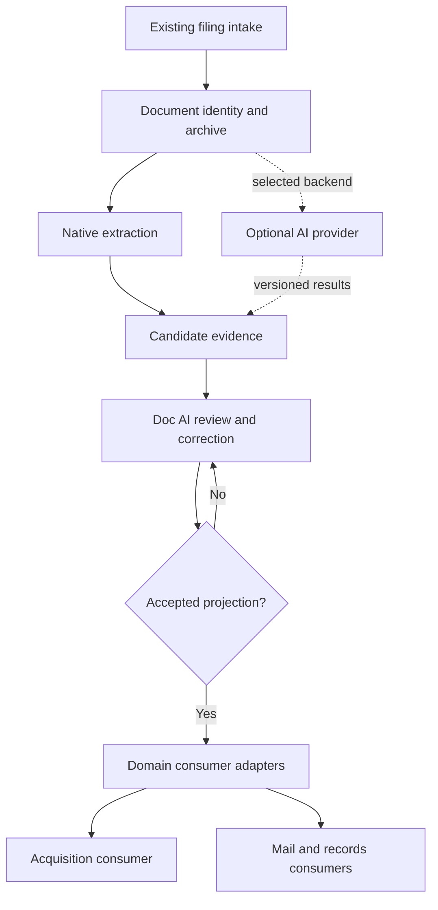

# Doc AI engine, application layer and optional providers

## Architecture decision

The product in the active workstream is Doc AI. Reuse native filing, document
identity, candidate facts and review mechanisms as inspectable code. The
existing swarm library supplies builders; it is separate from this product.
The [current-state audit](docai-current-state.md) records what exists, what is
unverified and what is missing. The [active plan](../plans/docai-ticket-plan.md)
governs implementation. The prior quote-to-offer build remains useful as a
downstream acquisition consumer.

The distinction is operational:

| Layer | Responsibility | Default dependency |
| --- | --- | --- |
| Doc AI engine | Identify/archive documents, extract native content, validate candidate facts and preserve provenance/review | Deterministic code; optional extraction backend |
| Doc AI application layer | Coordinate intake jobs, retries, review/correction, filing, reprocessing and exports | Document and evidence contracts plus existing service controls |
| Optional AI provider layer | Propose extracted content/facts through a versioned adapter | Selected local or hosted provider, readiness and evaluation |
| Downstream consumers | Apply accepted facts to mail, records, acquisitions or other domains | Reviewed, domain-bound facts |
| Builder swarm engine/layer | Schedule development work and route artifacts through existing ticket and review machinery | Development tooling, separate from Doc AI runtime |
| Possible future product agents | Execute separately specified bounded workflows | Separate design and authorization; not required for document extraction |

"AI later" means live inference is connected after the small document/review
workflow is ready. Provider interfaces, configuration/status and fake-adapter
tests are early work. Neither completion of financial models nor a complete
swarm runtime is a prerequisite for first Doc AI evaluation. Existing local
Ollama client code is reusable but its live connection is unverified. NVIDIA
inference is not connected in the inspected implementation.

An ordinary code engine can evaluate uncertain outcomes using explicit
probability inputs. Probabilistic calculations do not require an LLM or an
autonomous agent.

## Dependency structure

The first local increment now implements filing, native extraction, the narrow
invoice grammar, neutral candidate/review records and accepted export. The
dotted provider edge remains unimplemented integration. The older EvidenceStore
continues accepting its original manual/native_json methods for compatibility;
the new `br.docai.v1` contracts carry truthful provider provenance separately.
There is no need to relabel model output as native.

## Implemented local composition — November 22, 2026

`BL_ACQ` is the versioned implementation home for this increment. The initial
baseline is local commit `12df530eaa1e3ae73f620d71c326075de1b31c91`, whose tree
`42fe36afc14efd46fa441f76c50c6ee7b95980ec` equals the published PR15 baseline
tree. The source audit and existing organizational authority remain distinct
from this implementation choice. No older application database was migrated.

| Owning component | Implemented operation | Boundary |
| --- | --- | --- |
| `filing/inbox.py` | Original archive, compatible receipt, bounded native format parsing | Local OS ownership; explicit partial/error/OCR-needed results |
| `pilot/document_contracts.py` | Neutral document/run/candidate/review records and twelve class field registries | Registered class contracts do not imply twelve working field parsers |
| `pilot/document_native.py` | Bind real archived bytes and native coverage to the shared run contract | CPU parsing; no provider invocation |
| `pilot/document_invoice.py` | Exact labeled invoice grammar and integer-cent normalization | One narrow initial parser; candidates remain pending |
| `pilot/document_vault.py` | Append-only history, context filtering, correction/review CAS and accepted projection | Composes old EvidenceStore transactions; trusted local actor labels |
| `pilot/document_application.py` and `tools/run_docai.py` | Synchronous intake, inspect, review, correction and export | No service login, leased queue, automatic real-document approval or product agents |
| `tools/evaluate_docai_native.py` | Run the retained synthetic corpus and report observed coverage/errors | No fabricated reviewed accepts, provider cost or calibrated probabilities |

The [application guide](../guides/document_application.md) gives a source-to-field
walkthrough. Engine parsing and review rules remain outside the application
orchestrator. The existing downstream acquisition files below remain compatible.

The selected future adapter target is NVIDIA Parse 2.4 with the documented
Nemotron Parse model and page API, recorded in
[`config/docai-provider-target.json`](../../config/docai-provider-target.json).
L2 owns implementation under BR-DOC-012 and SW-13 owns independent review. This
target is not a registered runtime client, endpoint, credential or connection.
The generic disabled/mock seam BR-DOC-007 remains its next prerequisite.

Durable jobs, authenticated ACLs and retention propagation remain open, so the
local demonstration is partial evidence for the broader Gate A. R and CUDA are
preserved extension tracks. Bounded hashing, strings, native parsing and SQLite
remain on CPU; model page batching will need measured device/memory/precision
evidence before enabling a CUDA inference implementation.

## Shared swarm engine and layer

Reuse the existing PROJECT_INTERNAL ticket engine for durable build IDs,
dependencies, optimistic concurrency, evidence and SW-13 closure. Reuse the
Academy artifact/review runner through a build adapter. Attach the offline
resource scheduler as an advisory planning service. Preserve business
simulation states in their existing domain. A compatibility gate must cover
idempotency collisions and response consistency before shared engine reuse.

The swarm application layer is the existing authenticated work/skills/review
interface plus development executor adapters. The current scheduling script
does not launch workers, and a profile does not establish a deployed agent.
See [builder coordination](builder-swarm.md) for ownership and handoffs.

## Preserved acquisition/evidence engines

The existing acquisition workspace contains financial, valuation, funding,
ledger, storage, review, and connector authorization modules. Extend the
owning engine rather than moving its formulas into a document parser, user
interface, prompt, or independent production R implementation.

The acquisition document-evidence engine owns identity, provenance, review, time validity,
versioning, conflict detection, and accepted-input projection. The probability
engine owns the offer/scenario schema, event-tree calculation, conditioning,
cost treatment, constraints, and optional bounded numerical batches.

Relevant implementation paths for this increment are:

- `pilot/document_evidence.py` — document/claim/review state and projection.
- `pilot/offer_probability.py` — deterministic conditional outcome evaluation.
- `pilot/document_offer_layer.py` — composition and explicit field bindings.
- `tools/run_document_offer.py` — synthetic end-to-end invocation.
- `data/document_evidence/duplex_quote.json` and
  `data/offer_probability/duplex.json` — declared synthetic fixtures.

Existence of a path does not establish execution or production readiness.
Use the implementation tests and current delivery report for those claims.

## Existing acquisition evidence contract

The general Doc AI `br.docai.v1` contract now adds domain/subject/case references,
binary-document identity, extraction-run identity, truthful method/provider
metadata, completeness and page/span locations without forcing documents into
financial deals. The following describes the preserved acquisition projection.

A candidate input needs the following semantic fields, regardless of the
storage representation:

| Group | Required meaning |
| --- | --- |
| Identity | Deal, document, version, claim, review and source identifiers |
| Content identity | Original content hash and immutable source/version relationship |
| Location | Page or native structured location; region where supported |
| Value | Raw/canonical value, explicit type, units and currency when relevant |
| Time | Observation, effective, expiration and review times, plus analysis date |
| Authority | Source status and explicit named acceptance/rejection/conflict decision |
| Reproduction | Extraction/entry method, source reference and prior versions |
| Uncertainty | Missingness, ambiguity, contradictions, and unresolved review reasons |

Extraction correctness, document reliability, and future deal-outcome
probability are separate concepts. An OCR or retrieval score cannot establish
seller acceptance, financing certainty, ownership, or realized cash.

A newly entered claim is a candidate. A newer document does not authorize its
own values merely because it supersedes an older file. Accepted projections
must still evaluate review, deal binding, time, units, and conflicts.

## Downstream acquisition binding contract

The application layer receives an immutable offer packet and an explicit list
of evidence bindings. Each binding names the evidence field, target group,
target record ID, monetary key, and any declared analyst scenario offset.

Only permitted economic fields can be bound:

- Global buyer-closing and consumed-allowance amounts.
- Scenario resale, renovation, and carrying amounts.
- Offer purchase price and incremental timing cost.

Bindings cannot change investment policy, scenario probability weights,
seller acceptance probabilities, closing probabilities, or authority.
Those are different inputs with different evidence and review requirements.

A scenario offset is an analyst assumption. It must never be described as a
fact extracted from the document. Binding a $55,000 baseline quote to other
scenarios requires an explicit offset policy; a quote does not itself specify
the entire probability distribution.

Apply a complete binding set atomically. If any required evidence is pending,
stale, conflicting, incorrectly typed, in the wrong currency or attached to
the wrong deal, withhold the adjusted result. Retain the original assumptions
for inspection and show the specific hold.

Changing offer terms requires revalidating the action and its agreement or
closing assumptions. The current application holds changed offer terms
rather than silently carrying forward the old probabilities. In particular,
a live counter's conditioning premise cannot remain valid after changing
its exact terms.

An economic change also cannot silently reuse probabilities marked as an
external estimate. Hold that adjusted result for reassessment of the
estimate's applicability. The synthetic demonstration uses explicitly
illustrative assumptions. Preserve illustrative source status through the
projection and report; a manual review cannot convert a fictional document
into real evidence.

## Research output

Return a source-linked report containing:

- Layer, model, schema and input versions.
- Deal ID, analysis date, time zone and currency.
- Original input packet and explicit bindings.
- Evidence projection, source provenance and blockers.
- Baseline result and, only when valid, document-adjusted result.
- Before/document-value/analyst-offset/after amounts for changed fields.
- Digest for the complete report and evidence/model relationship.
- Actual execution backend and limitations.
- Explicit AI-disabled, runtime-agents-disabled and no-execution-authority flags.

The report can establish that the calculation is reproducible. It cannot
establish a real seller agreement, lender approval, closing, ownership,
receipt of cash, or institutional approval.

## Worked synthetic change

With the prior $505,000 offer, $35,000 baseline renovation and the other
specified costs, baseline profit is $47,000. A reviewed $55,000 renovation
quote reduces that baseline profit to $27,000:

    47,000 - (55,000 - 35,000) = 27,000 dollars

The previous baseline purchase-price ceiling of $507,000 therefore becomes
$487,000 if every other baseline cost and the $45,000 profit requirement
remain unchanged.

For the four-scenario demonstration, explicit renovation offsets of $0, $0,
$10,000 and $20,000 preserve the analyst's original scenario buffers above
the revised quote. This is a declared scenario policy, not a hidden claim
from the source. The probability weights remain unchanged unless separately
reviewed inputs change them.

## Independent buyable, fundable, and sellable checks

Documents can contribute evidence to three independent dimensions:

| Dimension | Evidence question | Status limitation |
| --- | --- | --- |
| Buyable | Can the exact opportunity be acquired under the required terms and authority? | A quote or seller message is not completed ownership |
| Fundable | Is sufficient eligible capital available under current conditions? | A preliminary term sheet is not unconditional funding |
| Sellable or operable | Does the exit/operating thesis have current supporting demand, cost and use evidence? | An asking rent or sale estimate is not realized revenue |

A positive dimension does not substitute for another. Model returns and
operating permissions remain separate. Final cash reconciliation must use
actual obligations, invoices, independently supported receipts, and the
ledger's correction rules.

## CUDA and R

Batch independent deals, offers and scenarios while preserving each case's
financial dependencies. Keep exact/high-precision CPU reference semantics,
explicit backend selection, bounded memory, and actual-device performance
evidence. Persistence, authorization, file identity and small control-flow
operations can remain on CPU; moving them to a GPU without measured benefit
does not serve the user's utilization objective.

R receives a versioned review exchange and can later provide independent
numeric checks, calibration, survival analysis and reporting. The Python
rules remain authoritative. The [R exchange guide](../guides/r-evidence-validation.md)
states the actual current export contract and runtime limitations.

## Optional NVIDIA provider milestone

Current official NVIDIA documentation describes NeMo Retriever Library as
document-extraction and retrieval orchestration. Individual Parse, OCR,
embedding and reranking services are selectable components. Pin the chosen
library, model, NIM, client and supported hardware combination before
implementation.

The current standalone Nemotron Parse NIM API uses a rendered page image
submitted to `POST /v1/parse`. Older VLM examples used chat completions and
cannot be copied unchanged into that service. Supported device profiles and
the library's integration capabilities must be checked for the exact selected
versions.

The early provider contract must return candidate claims, locations, model and
method versions, errors, and raw supporting output. The same source-review
and application-binding rules apply. Model inference scores do not become
deal-outcome probabilities.

A first live test is a bounded evaluation after native intake, provenance,
review, error handling, endpoint/auth, allowed-data, version and budget gates.
Hosted client implementation does not require a local GPU; self-hosted
inference does. Production enablement follows held-out quality, review-burden,
latency/cost and recovery evidence. Retrieval/reranking can follow the first
useful reviewed extraction. No provider is enabled by this document.

Primary references, checked for this architecture on November 22, 2026:

- [NeMo Retriever Library overview](https://docs.nvidia.com/nemo/retriever/latest/extraction/overview/)
- [Nemotron Parse NIM overview and migration](https://docs.nvidia.com/nim/ingestion/parse/latest/overview.html)
- [Nemotron Parse support matrix](https://docs.nvidia.com/nim/ingestion/parse/latest/support-matrix.html)
- [CUDA best practices and reference comparison](https://docs.nvidia.com/cuda/cuda-c-best-practices-guide/)
