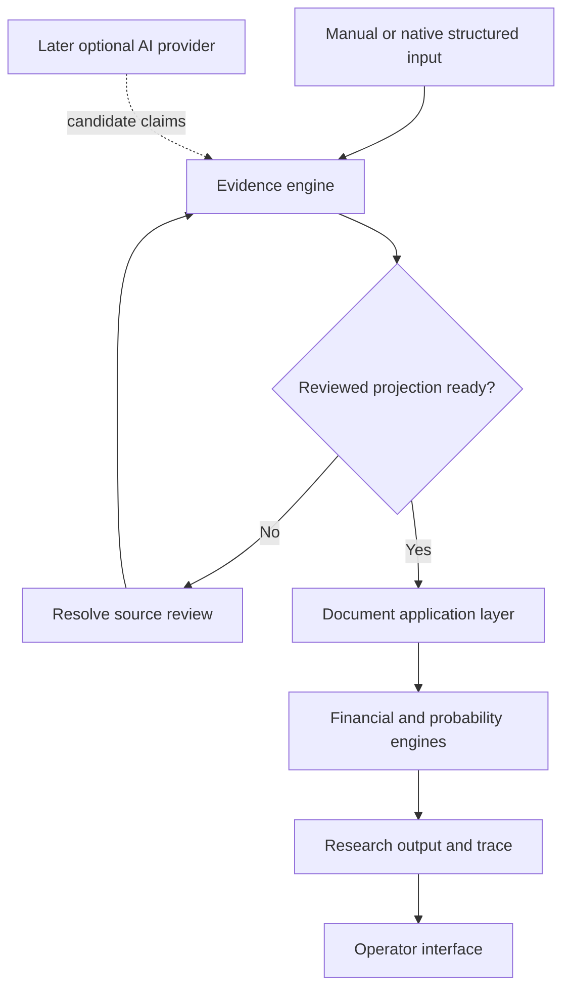

# Document evidence, acquisition engines, and later AI

## Architecture decision

Build the product's financial and evidence mechanics as inspectable code.
Use the current swarm to build that code. Keep AI service inference and
product-agent autonomy outside the default runtime.

The distinction is operational:

| Layer | Responsibility | Default dependency |
| --- | --- | --- |
| Engine core | Validate/store evidence, calculate finances and conditional probability outcomes | Ordinary code and explicitly supplied data |
| Application layer | Apply reviewed evidence to permitted model fields, recompute and preserve traces | Engine APIs |
| Interface and integrations | Let an operator inspect sources, assumptions, results and actions | Application services |
| Later assistive AI | Propose extractions, retrieve evidence, or explain a result | Optional provider adapters and evaluation |
| Later product agents | Execute separately permitted bounded workflows, if justified | Independently designed authority, tools and operating controls |

An ordinary code engine can evaluate uncertain outcomes using explicit
probability inputs. Probabilistic calculations do not require an LLM or an
autonomous agent.

## Dependency structure

The dotted provider edge is a future interface. It is not a deployed model
service. Core modules do not import or call an AI provider.

## Core engines

The existing acquisition workspace contains financial, valuation, funding,
ledger, storage, review, and connector authorization modules. Extend the
owning engine rather than moving its formulas into a document parser, user
interface, prompt, or independent production R implementation.

The document-evidence engine owns identity, provenance, review, time validity,
versioning, conflict detection, and accepted-input projection. The probability
engine owns the offer/scenario schema, event-tree calculation, conditioning,
cost treatment, constraints, and optional bounded numerical batches.

Relevant implementation paths for this increment are:

- `pilot/document_evidence.py` — document/claim/review state and projection.
- `pilot/offer_probability.py` — deterministic conditional outcome evaluation.
- `pilot/document_offer_layer.py` — composition and explicit field bindings.
- `tools/run_document_offer.py` — synthetic end-to-end invocation.
- `data/document_evidence/duplex_quote.json` and
  `data/offer_probability/duplex.json` — declared synthetic fixtures.

Existence of a path does not establish execution or production readiness.
Use the implementation tests and current delivery report for those claims.

## Evidence contract

A candidate input needs the following semantic fields, regardless of the
storage representation:

| Group | Required meaning |
| --- | --- |
| Identity | Deal, document, version, claim, review and source identifiers |
| Content identity | Original content hash and immutable source/version relationship |
| Location | Page or native structured location; region where supported |
| Value | Raw/canonical value, explicit type, units and currency when relevant |
| Time | Observation, effective, expiration and review times, plus analysis date |
| Authority | Source status and explicit named acceptance/rejection/conflict decision |
| Reproduction | Extraction/entry method, source reference and prior versions |
| Uncertainty | Missingness, ambiguity, contradictions, and unresolved review reasons |

Extraction correctness, document reliability, and future deal-outcome
probability are separate concepts. An OCR or retrieval score cannot establish
seller acceptance, financing certainty, ownership, or realized cash.

A newly entered claim is a candidate. A newer document does not authorize its
own values merely because it supersedes an older file. Accepted projections
must still evaluate review, deal binding, time, units, and conflicts.

## Application-layer binding contract

The application layer receives an immutable offer packet and an explicit list
of evidence bindings. Each binding names the evidence field, target group,
target record ID, monetary key, and any declared analyst scenario offset.

Only permitted economic fields can be bound:

- Global buyer-closing and consumed-allowance amounts.
- Scenario resale, renovation, and carrying amounts.
- Offer purchase price and incremental timing cost.

Bindings cannot change investment policy, scenario probability weights,
seller acceptance probabilities, closing probabilities, or authority.
Those are different inputs with different evidence and review requirements.

A scenario offset is an analyst assumption. It must never be described as a
fact extracted from the document. Binding a $55,000 baseline quote to other
scenarios requires an explicit offset policy; a quote does not itself specify
the entire probability distribution.

Apply a complete binding set atomically. If any required evidence is pending,
stale, conflicting, incorrectly typed, in the wrong currency or attached to
the wrong deal, withhold the adjusted result. Retain the original assumptions
for inspection and show the specific hold.

Changing offer terms requires revalidating the action and its agreement or
closing assumptions. The current application holds changed offer terms
rather than silently carrying forward the old probabilities. In particular,
a live counter's conditioning premise cannot remain valid after changing
its exact terms.

An economic change also cannot silently reuse probabilities marked as an
external estimate. Hold that adjusted result for reassessment of the
estimate's applicability. The synthetic demonstration uses explicitly
illustrative assumptions. Preserve illustrative source status through the
projection and report; a manual review cannot convert a fictional document
into real evidence.

## Research output

Return a source-linked report containing:

- Layer, model, schema and input versions.
- Deal ID, analysis date, time zone and currency.
- Original input packet and explicit bindings.
- Evidence projection, source provenance and blockers.
- Baseline result and, only when valid, document-adjusted result.
- Before/document-value/analyst-offset/after amounts for changed fields.
- Digest for the complete report and evidence/model relationship.
- Actual execution backend and limitations.
- Explicit AI-disabled, runtime-agents-disabled and no-execution-authority flags.

The report can establish that the calculation is reproducible. It cannot
establish a real seller agreement, lender approval, closing, ownership,
receipt of cash, or institutional approval.

## Worked synthetic change

With the prior $505,000 offer, $35,000 baseline renovation and the other
specified costs, baseline profit is $47,000. A reviewed $55,000 renovation
quote reduces that baseline profit to $27,000:

    47,000 - (55,000 - 35,000) = 27,000 dollars

The previous baseline purchase-price ceiling of $507,000 therefore becomes
$487,000 if every other baseline cost and the $45,000 profit requirement
remain unchanged.

For the four-scenario demonstration, explicit renovation offsets of $0, $0,
$10,000 and $20,000 preserve the analyst's original scenario buffers above
the revised quote. This is a declared scenario policy, not a hidden claim
from the source. The probability weights remain unchanged unless separately
reviewed inputs change them.

## Independent buyable, fundable, and sellable checks

Documents can contribute evidence to three independent dimensions:

| Dimension | Evidence question | Status limitation |
| --- | --- | --- |
| Buyable | Can the exact opportunity be acquired under the required terms and authority? | A quote or seller message is not completed ownership |
| Fundable | Is sufficient eligible capital available under current conditions? | A preliminary term sheet is not unconditional funding |
| Sellable or operable | Does the exit/operating thesis have current supporting demand, cost and use evidence? | An asking rent or sale estimate is not realized revenue |

A positive dimension does not substitute for another. Model returns and
operating permissions remain separate. Final cash reconciliation must use
actual obligations, invoices, independently supported receipts, and the
ledger's correction rules.

## CUDA and R

Batch independent deals, offers and scenarios while preserving each case's
financial dependencies. Keep exact/high-precision CPU reference semantics,
explicit backend selection, bounded memory, and actual-device performance
evidence. Persistence, authorization, file identity and small control-flow
operations can remain on CPU; moving them to a GPU without measured benefit
does not serve the user's utilization objective.

R receives a versioned review exchange and can later provide independent
numeric checks, calibration, survival analysis and reporting. The Python
rules remain authoritative. The [R exchange guide](../guides/r-evidence-validation.md)
states the actual current export contract and runtime limitations.

## Later NVIDIA layer

Current official NVIDIA documentation describes NeMo Retriever Library as
document-extraction and retrieval orchestration. Individual Parse, OCR,
embedding and reranking services are selectable components. Pin the chosen
library, model, NIM, client and supported hardware combination before
implementation.

The current standalone Nemotron Parse NIM API uses a rendered page image
submitted to `POST /v1/parse`. Older VLM examples used chat completions and
cannot be copied unchanged into that service. Supported device profiles and
the library's integration capabilities must be checked for the exact selected
versions.

The future provider contract returns candidate claims, locations, model and
method versions, errors, and raw supporting output. The same source-review
and application-binding rules apply. Model inference scores do not become
deal-outcome probabilities.

No cloud document upload, model installation, provider invocation, or
autonomous runtime is enabled by this architecture document.

Primary references, checked for this architecture on November 22, 2026:

- [NeMo Retriever Library overview](https://docs.nvidia.com/nemo/retriever/latest/extraction/overview/)
- [Nemotron Parse NIM overview and migration](https://docs.nvidia.com/nim/ingestion/parse/latest/overview.html)
- [Nemotron Parse support matrix](https://docs.nvidia.com/nim/ingestion/parse/latest/support-matrix.html)
- [CUDA best practices and reference comparison](https://docs.nvidia.com/cuda/cuda-c-best-practices-guide/)
