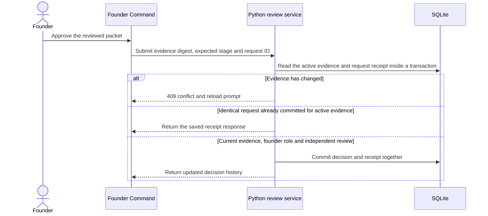

# How to model Black River

**Architecture** is the set of structural and behavioral decisions that make Black River work. **A system model** represents selected parts of that system and how they relate. **An architecture description** organizes those models, the stakeholder questions they answer, the reasons behind decisions, and their relationship to requirements and tests.

ISO/IEC/IEEE 42010 concerns the architecture description. A practical division of labor for Black River is to use C4-style views for software structure, Mermaid for diagrams kept with the code, and a model-based systems engineering tool when several teams need to maintain linked requirements, interfaces and verification cases in one model. SysML is an industry-standard modeling language for the latter. This guide uses the standards as references. Formal conformance has not been assessed. [ISO/IEC/IEEE 42010](https://www.iso.org/standard/74393.html) · [C4 diagrams](https://c4model.com/diagrams) · [OMG SysML](https://www.omg.org/sysml/)

## Start with a question and a boundary

For **Machine of Machines**, start with the founder's question. _Can I reconstruct exactly which evidence a person approved?_ Model the local Founder Command pilot first. Its boundary includes the browser, Python service, underwriter and SQLite database. In a separate target context view, show independently operated parcel sources, design tools and payment providers. Label their handoffs as planned.

| Stakeholder and concern | Viewpoint and model kind | What the Black River view shows |
| --- | --- | --- |
| Buyer needs to understand scope and value | Context view with an actor and system diagram | Analyst, independent reviewer and founder use Black River. Proposed parcel, design and settlement connections belong in the target view. |
| Engineer needs to identify responsibility and data ownership | Software structure view using a C4-style container and component model | Browser presents. Python checks authority and applies the business rules. SQLite records evidence, decisions and request receipts. |
| Reviewer needs to understand ordering and failure behavior | Dynamic view using a sequence model or state transition table | Independent review precedes approval. Evidence rollover invalidates the prior review for the active packet. |
| Operator needs to prove recovery | Verification view using a requirement-to-test matrix | A fresh checkout can execute the workflow and verify the SQLite restore. |

A **viewpoint** describes how to answer a type of question. A **view** is the answer for this system. A **model kind** defines what the view can express. For example, a sequence model expresses messages over time. A deployment model expresses where the applications and data stores run.

## Worked model for a versioned approval

The service publishes an evidence packet with a digest. This diagram shows the approval request after independent review.

The decision to bind each approval to an evidence digest is an **architecture decision**. The trade-off is that re-publishing evidence can require a second review. It preserves which version the founder saw. The code uses a transaction so recording the decision and receipt succeeds or rolls back together. [Service implementation](../../pilot/founder_service.py) · [Service walkthrough](../../pilot/founder_service.md)

| Rule to trace | Code or model element | Evidence |
| --- | --- | --- |
| A changed packet requires a fresh review. | Active evidence digest and stage guard. | `test_evidence_revision_is_frozen_and_requires_new_review`. |
| Retrying or racing a decision preserves one decision. | Scoped request receipt and transactional stage check. | `test_competing_and_repeated_decision`. |
| An unapproved deal leaves settlement untouched. | Approval gate before the acceptance settlement step. | `test_unapproved_deal_has_no_settlement_side_effect`. |
| The approval and settlement record survive recovery. | SQLite backup and a restored-record comparison. | `test_recovered_service_has_distinct_sources_and_replays_once`. |

Run the walkthrough with `code-map.cmd teach` and follow the [connected service tests](../../tests/test_founder_service.py) and [recovery tests](../../tests/test_acceptance.py). Repeat this pattern when adding a machine. Name the stakeholder concern, draw one view, specify the inputs and authority, record the decision and connect it to a test.

## Which software to use

These are common choices by use case. General diagramming and formal systems modeling serve different audiences, so compare tools within their category. No market-share ranking is assumed.

| Use case | Free or no-cost option | Paid option |
| --- | --- | --- |
| Draw diagrams by hand and explain them in a meeting | **draw.io / diagrams.net** has a free web editor and an offline Windows app. [Official apps](https://www.drawio.com/docs/integrations/) | **Microsoft Visio** suits Microsoft 365 teams that exchange Visio files. U.S. list prices are **$5/user/month** for Plan 1 and **$15/user/month** for Plan 2, billed annually, as checked November 20, 2026. Basic web features are included in eligible commercial Microsoft 365 plans. [Microsoft plans and pricing](https://www.microsoft.com/en-us/microsoft-365/visio/visio-plans-and-pricing) |
| Keep diagrams next to code, decisions and tests | **Mermaid + Markdown + GitHub** is the style Black River uses today. Edit the text in your repository and review diagram changes with the code. [Mermaid guide](https://mermaid.js.org/intro/getting-started) | A team can use a commercial diagramming tool where shared editing and presentation files are the main deliverable. Keep the technical source references with the repository. |
| Maintain a structured system model with requirements, interfaces and behavior | **Eclipse Capella** is open source and uses the Arcadia method. **CATIA Magic/Cameo SysML v2 Community Edition** offers a no-cost learning option for a team specifically exploring SysML v2. [Capella](https://mbse-capella.org/) · [Community Edition](https://www.3ds.com/products/catia/catia-magic/sysmlv2) | **Sparx Enterprise Architect** and **Cameo Systems Modeler / CATIA Magic** support formal systems modeling and traceability. Check the edition, supported SysML version and collaboration license before buying. [Sparx editions](https://sparxsystems.com/products/ea/shop/) · [Dassault product guide](https://www.3ds.com/products/catia/no-magic/cameo-systems-modeler) |

For **Black River today**, start with Mermaid in the repo for the technical record and draw.io when you want to sketch live. If you want to learn formal modeling without paying, take just the approval example above into Capella or the SysML v2 Community Edition. Use the same requirement, actors, evidence packet and acceptance tests so you can compare the tools using a real workflow.
