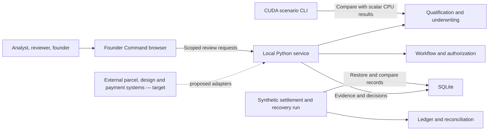

# Black River · Machine of Machines

**Black River** is the product. **Machine of Machines** is its architectural vision. It describes a platform that coordinates specialist systems and engines so one deal can move from evidence to an accountable decision and a reconciled outcome.

The working pilot runs as a modular application with a browser, a local Python service, and SQLite. The broader design includes separately operated parcel sources, design tools, and commercial systems. Systems engineering uses **system of systems** for a collection whose constituents can serve useful purposes independently and retain some control over their own operation and evolution. Use **subsystem**, **component**, or **engine** for an internal part of the pilot. [Systems engineering terminology](https://sebokwiki.org/wiki/System_of_Systems_%28SoS%29)

## Use the name that answers the question

| Question | Industry term | Black River wording and example |
| --- | --- | --- |
| What whole product are we discussing? | **System of interest** | Black River. The architecture boundary includes the software, operators, and agreements needed to process a deal. |
| What outside systems cooperate with it? | **Constituent or external system** | A county parcel source, a design tool such as Rhino or SketchUp, or a settlement provider in the target architecture. Each has its own owner and interface. |
| What business work does it support? | **Domain and subdomain** | Real estate investing and operations is the domain. Acquisitions, underwriting, design, and accounting are subdomains. |
| What can the business accomplish? | **Capability** | Qualify a property, establish a purchase ceiling, record approval, or reconcile a receipt. A capability states the outcome. |
| Where do terms and rules have a consistent meaning? | **Bounded context** | The acquisition model governs a proposed price. The accounting model governs invoice and receipt evidence. They refer to the same deal through an explicit link. [Domain-driven design](https://martinfowler.com/bliki/BoundedContext.html) |
| What kind of responsibility is this? | **Layer** | The presentation layer displays evidence. The application layer coordinates review. The domain layer applies underwriting rules. The persistence layer records state. |
| What specialist work happens inside a layer? | **Component or engine** | Keep the familiar names **Underwriting Engine**, **CUDA Scenario Engine**, and **Ledger Engine**. Each name identifies a responsibility. |
| What runs, and where? | **Application, service, data store, deployment node** | The browser runs JavaScript, the Founder service exposes local HTTP routes, and SQLite is the embedded data store. Windows and its optional NVIDIA GPU are deployment resources. |
| What does one part promise another? | **Interface, contract, schema** | A connector exposes an interface. Its contract defines meaning, units, authority, and failure behavior. Its schema defines the data shape. OpenAPI is an industry specification for describing an HTTP interface. [OpenAPI specification](https://spec.openapis.org/oas/) |
| How does work move? | **Workflow, orchestration, state transition** | Evidence review precedes approval. Orchestration coordinates the order. A transition records a move from one permitted state to another. |
| Who or what performs work? | **Actor, role, worker, agent** | The founder is a human actor with an approval role. A worker processes leased tasks. An agent can analyze or propose work within granted permissions. A swarm coordinates reviewers and specialists. |
| What is true, and how do we know? | **Source of truth, provenance, version, audit trail** | An immutable packet identifies exactly what was reviewed. The approval is a recorded decision. Receipt evidence establishes simulated settlement in the ledger. |
| How do we govern a change? | **Requirement, architecture decision record, acceptance test, release gate** | BR-ENG describes the requirement. An ADR records the choice and trade-offs. A test verifies the behavior. The delivery issue records the evidence and release status. |

**Keep the two vocabularies together.** Founder Command is the product-facing name for the review workspace. Engine identifies specialist processing. Swarm identifies coordinated people or agents. In an architecture diagram, show which concrete component, service, role, or task those names denote.

## Four architecture views

The views below follow the industry practice of describing a system from different stakeholder concerns. Use ISO/IEC/IEEE 42010:2022 for architecture-description terminology and C4 for the levels of zoom. Black River uses these as documentation references. Formal conformance has not been assessed. [Architecture description standard](https://www.iso.org/standard/74393.html) · [C4 diagram definitions](https://c4model.com/diagrams)

| View | Whose question it answers | What to show |
| --- | --- | --- |
| **Context** | Founder or buyer asking where the product fits | People, Black River and the outside systems around it. Label proposed integrations explicitly. |
| **Container and deployment** | CTO or operator asking what runs where | Browser, Python service and SQLite store. A C4 container is an application or data store. Deployment shows that the current connected service binds to the Windows host's loopback interface. |
| **Component and code** | Engineer asking where to make a change | Underwriting, persistence, connector gate, ledger, CUDA screen and their files. The source map gives the starting point and test. |
| **Dynamic and assurance** | Reviewer asking how a decision travels and survives failure | Sequence of evidence review, approval, settlement and restore. Show the actor, evidence version, retry behavior and test coverage. |

## Follow one handoff from business to code

1. **Business capability.** The analyst qualifies Orchard and proposes a purchase price. The underwriting engine computes a **$235,000** binding ceiling in the synthetic fixture. The cap is a domain result with supporting assumptions. [Underwriting walkthrough](../guides/underwriting.md)
2. **Interface and authority.** Founder Command sends a scoped request with the selected evidence version and expected revision. The service checks scope and role. A separate reviewer and founder leave distinct decisions. A stale evidence version returns a conflict and requires a fresh review. [Connected service](../../pilot/founder_service.md)
3. **Persistence and recovery.** SQLite stores distinct evidence, decisions, tasks, and request receipts. A repeated request reuses its receipt with the same input. The synthetic acceptance run links separate invoice and receipt evidence, reconciles the four entities, and verifies the restored state. [Backup and recovery walkthrough](../guides/pilot_acceptance.md)
4. **Acceleration.** The CUDA scenario engine runs beside the workflow. It explores a batch of downside assumptions and compares results to the CPU reference. The decision still uses the versioned underwriting packet and human approval. [CUDA architecture decision](cuda-screening.md)

When adding another machine, document its **owner, capability, input and output contract, source and version, authority, failure and retry behavior, and acceptance evidence**. Capture public and private boundaries explicitly. The [engine inventory](intelligence-engines.md) tracks each planned or working family and its backlog references. The [code map](../code-map.md) links maintained files to their walkthroughs.

## Explain it to a buyer

> Black River connects property evidence, underwriting, founder review, and settlement. The current pilot lets an analyst show what the firm can afford to pay, the evidence behind that number, and who reviewed it. The larger architecture adds parcel and design systems through explicit interfaces so the team can preserve that record from intake through reconciliation.
